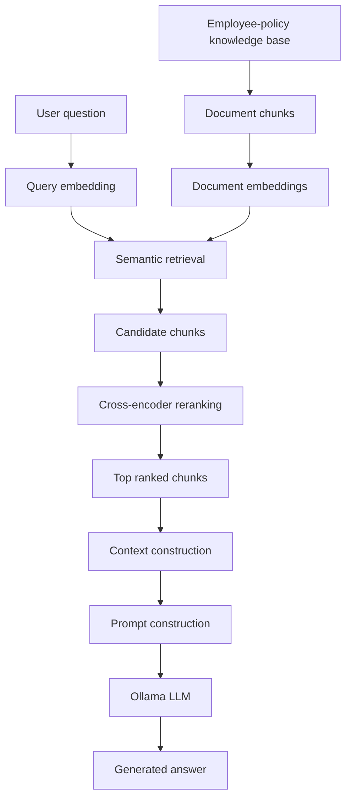

# Mini RAG Lab


A small, hands-on Python project for learning the building blocks of a Retrieval-Augmented Generation (RAG) system with Sentence Transformers and a locally hosted Ollama model.

## Overview

Mini RAG Lab answers questions about a small, in-memory employee-policy knowledge base. It demonstrates the full path from semantic retrieval to a context-grounded answer:

1. Split the source policy into chunks.
2. Create and normalize document embeddings.
3. Retrieve the most similar chunks for a question.
4. Rerank retrieved candidates with a cross-encoder.
5. Build context and a grounded prompt.
6. Generate an answer with Ollama.

The code is intentionally split into focused modules so that each stage can be studied, run, and changed independently.

## Features

- Chapter-aware document chunking for the core knowledge base, plus standalone chunking experiments.
- Semantic retrieval with `sentence-transformers/all-MiniLM-L6-v2` and cosine similarity.
- Cross-encoder reranking with `cross-encoder/ms-marco-MiniLM-L-6-v2`.
- Context and prompt builders that instruct the model to answer only from the retrieved context.
- Local answer generation through Ollama's HTTP API.
- Retrieval and reranking evaluation scripts with Recall, Precision, and MRR metrics.
- End-to-end RAG pipeline evaluation with answer checks for answerable, multi-condition, unanswerable, and robustness cases.
- JSON evaluation reports with per-case results, missing expected points, and aggregate pass rate.

## Architecture



`rag_pipeline.py` coordinates the end-to-end pipeline. The knowledge base is currently defined in `mini_rag.py`; no external vector database or document-ingestion step is included.

## Project Structure

```text
mini-rag-lab/
├── examples/                   # Small, focused demonstrations
│   ├── chunking_demo.py
│   ├── embedding_demo.py
│   ├── reranker_demo.py
│   ├── context_builder_demo.py
│   ├── prompt_builder_demo.py
│   ├── llm_client_demo.py
│   └── rag_pipeline_demo.py
├── experiments/                # Alternative chunking experiments
├── evaluation_reports/         # Generated evaluation reports (gitignored)
├── mini_rag.py                 # Knowledge base, embeddings, and retrieval
├── reranker.py                 # Reusable cross-encoder reranking function
├── context_builder.py          # Converts ranked chunks into LLM context
├── prompt_builder.py           # Creates the grounded answer prompt
├── llm_client.py               # Ollama HTTP client and model configuration
├── rag_pipeline.py             # End-to-end question-answering pipeline
├── pipeline_evaluation.py     # End-to-end RAG answer evaluation
├── evaluation.py               # Retrieval metrics: Recall@K and Precision@K
├── reranker_evaluation.py      # Baseline-versus-reranked metrics
├── .gitignore
├── requirements.txt
└── README.md
```

## Requirements

- Python 3.12 (the version used by this project)
- [Ollama](https://ollama.com/)
- Internet access on first run to download the Sentence Transformers models

Python dependencies are pinned in `requirements.txt`:

- NumPy
- Requests
- Sentence Transformers

## Installation

Clone the repository and enter the project directory:

```bash
git clone <your-repository-url>
cd mini-rag-lab
```

Create and activate a virtual environment.

macOS / Linux:

```bash
python3.12 -m venv .venv
source .venv/bin/activate
```

Windows PowerShell:

```powershell
py -3.12 -m venv .venv
.venv\Scripts\Activate.ps1
```

Install the Python packages:

```bash
python -m pip install --upgrade pip
python -m pip install -r requirements.txt
```

Install the local model used by `llm_client.py`:

```bash
ollama pull qwen3:4b-instruct
```

Start Ollama if it is not already running:

```bash
ollama serve
```

The client sends requests to `http://localhost:11434/api/generate`. To use another locally available model, update `MODEL_NAME` in `llm_client.py`.

## Usage

Run the end-to-end example from the project root:

```bash
python -m examples.rag_pipeline_demo
```

The example asks a question that is deliberately outside the employee-policy knowledge base. A well-grounded response should state that the provided context does not contain the answer.

To inspect retrieval without calling Ollama:

```bash
python mini_rag.py
```

Other focused examples can be run in the same way:

```bash
python -m examples.chunking_demo
python -m examples.embedding_demo
python -m examples.reranker_demo
python -m examples.context_builder_demo
```

Examples that call `llm_client.generate()` require Ollama and the configured model to be available:

```bash
python -m examples.llm_client_demo
python -m examples.prompt_builder_demo
```

## Evaluation

Evaluate the embedding retriever over the built-in labelled question set:

```bash
python evaluation.py
```

The script reports per-question and macro-average `Recall@3` and `Precision@3`.

Compare retrieval ordering before and after reranking:

```bash
python reranker_evaluation.py
```

This reports macro-average `Recall@1`, `MRR@3`, `Recall@3`, and `Recall@5`. The current evaluation set is small and based on the in-memory employee-policy document, so results are useful for learning and regression checks rather than as a production benchmark.

### End-to-End Pipeline Evaluation

Run the 15-case evaluation of retrieval, reranking, context construction, and answer generation:

```bash
python pipeline_evaluation.py
```

The cases cover four categories: `answerable`, `multi_condition`, `unanswerable`, and `robustness`. The script prints each result and writes a JSON report to `evaluation_reports/pipeline_evaluation.json`.

The evaluator uses basic keyword matching for expected answer points and an exact refusal-phrase check. A 100% pass rate on these 15 cases is a useful learning check, not a claim of production reliability.

## Limitations

- The knowledge base is hard-coded and small; documents are not loaded from files or external services.
- All document embeddings are kept in memory; there is no persistent vector store.
- The code does not include automated tests, an API, or a user interface.
- First use downloads the embedding and reranking models, and generation depends on a local Ollama service.

## Learning Path

For a gradual walkthrough, start with the chunking and embedding examples, then run `mini_rag.py`, `python -m examples.reranker_demo`, and finally `python -m examples.rag_pipeline_demo`. The scripts under `experiments/` compare simple, sentence-aware, recursive, and boundary-aware chunking approaches.
